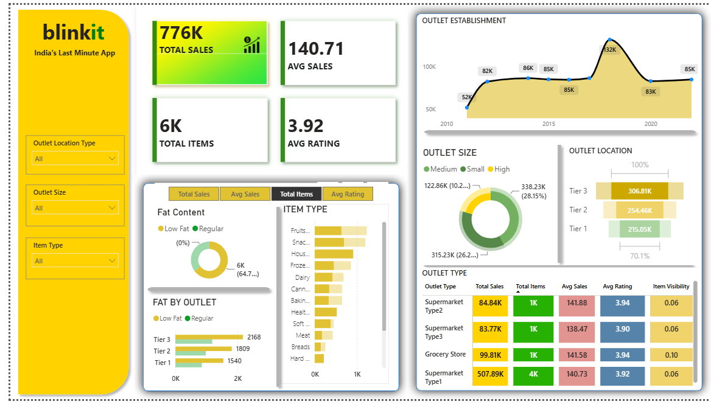

# Blinkit Sales Analysis Dashboard

## Project Overview
This project is an interactive sales analysis dashboard created using Microsoft Power BI to analyze Blinkit sales performance and outlet trends.

## Dashboard Preview

## Key Performance Indicators
- **Total Sales:** 776K
- **Average Sales:** 140.71
- **Total Items:** 6K
- **Average Rating:** 3.92

## Key Insights
- Sales analysis by fat content and item type.
- Comparison of outlet sizes and outlet locations.
- Analysis of outlet establishment trends.
- Comparison of outlet types using sales, item counts, average sales, and ratings.

## Tools Used
- Microsoft Power BI
- Data visualization
- Interactive filters and dashboard design

## Project Files
- `Blinkit_Sales_Analysis.pbix` — Interactive Power BI report.
- `dashboard.png` — Dashboard screenshot.
- `Blinkit_Dashboard.pdf` — PDF version, if included.

## How to Use
1. Download the `.pbix` file from this repository.
2. Open it in Microsoft Power BI Desktop.
3. If necessary, update the data source path.
4. Explore the dashboard visuals and filters.

## Author
Created as a data visualization project using Microsoft Power BI.
